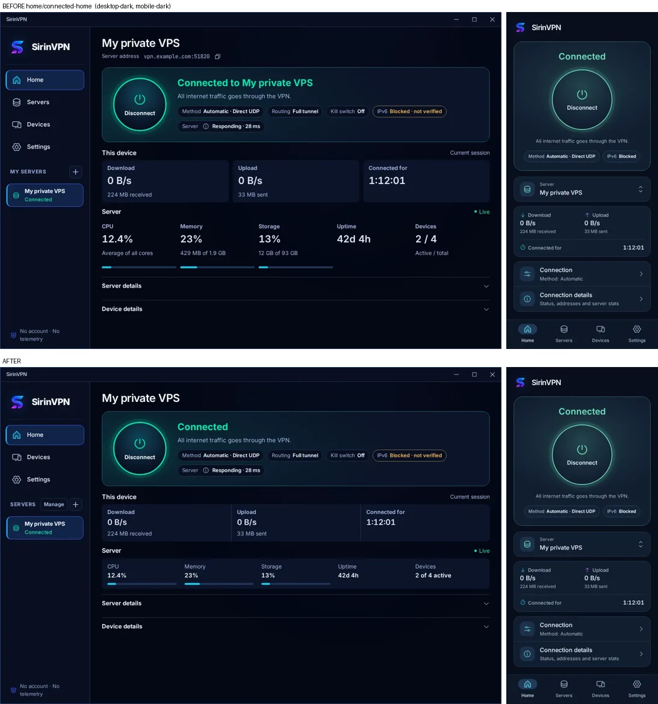
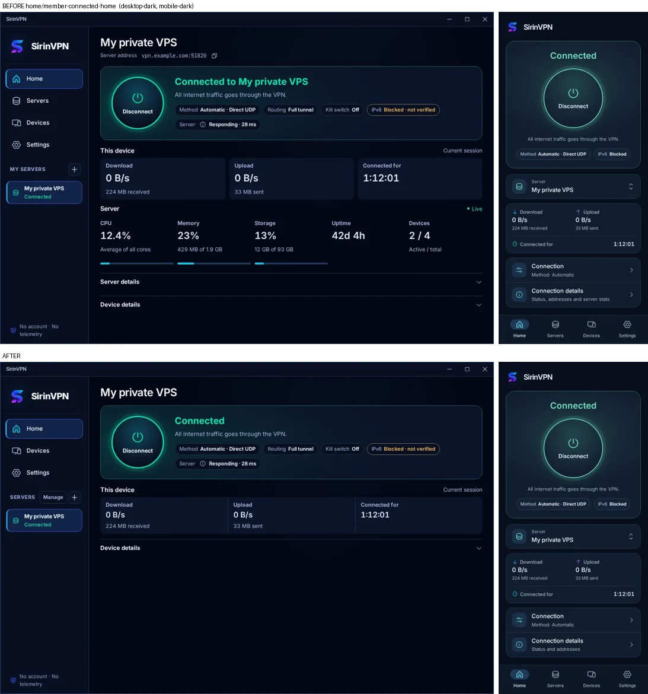
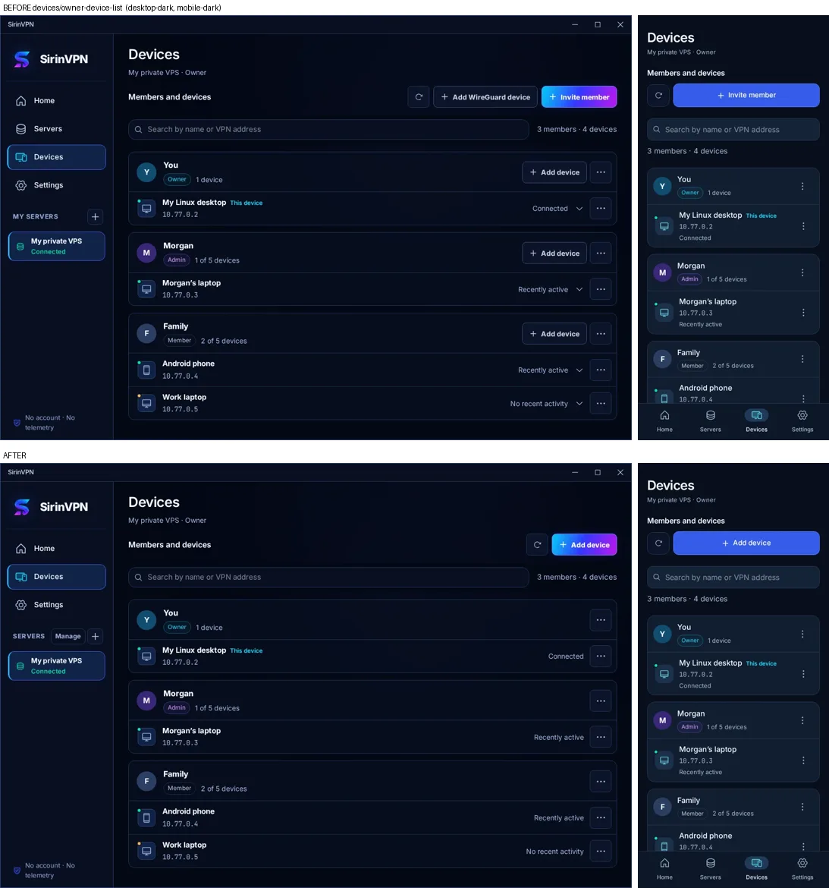
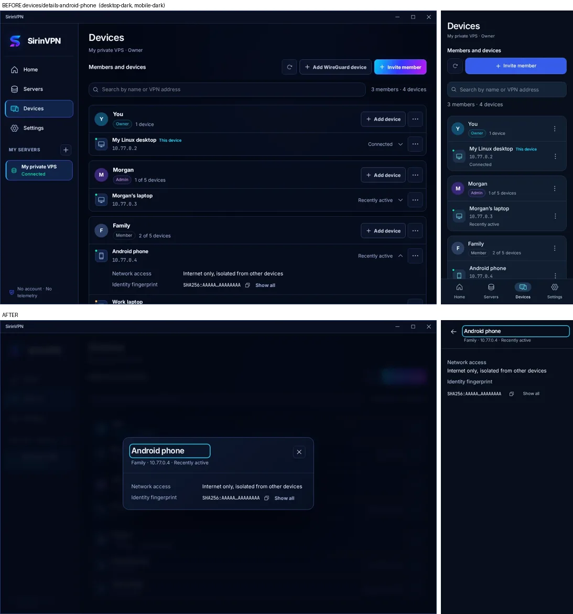
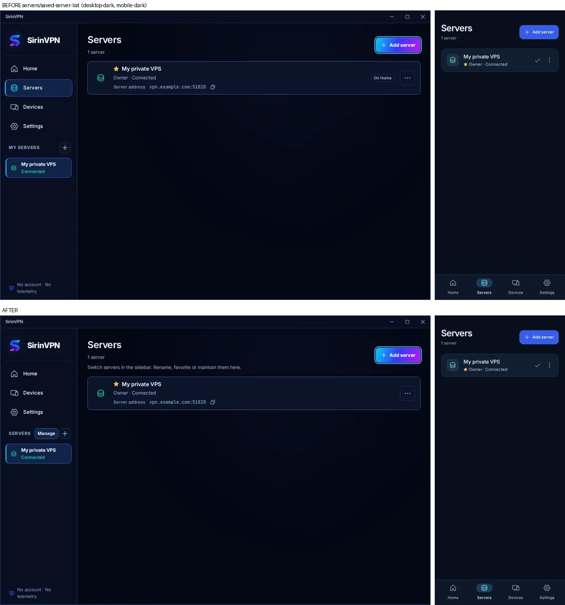
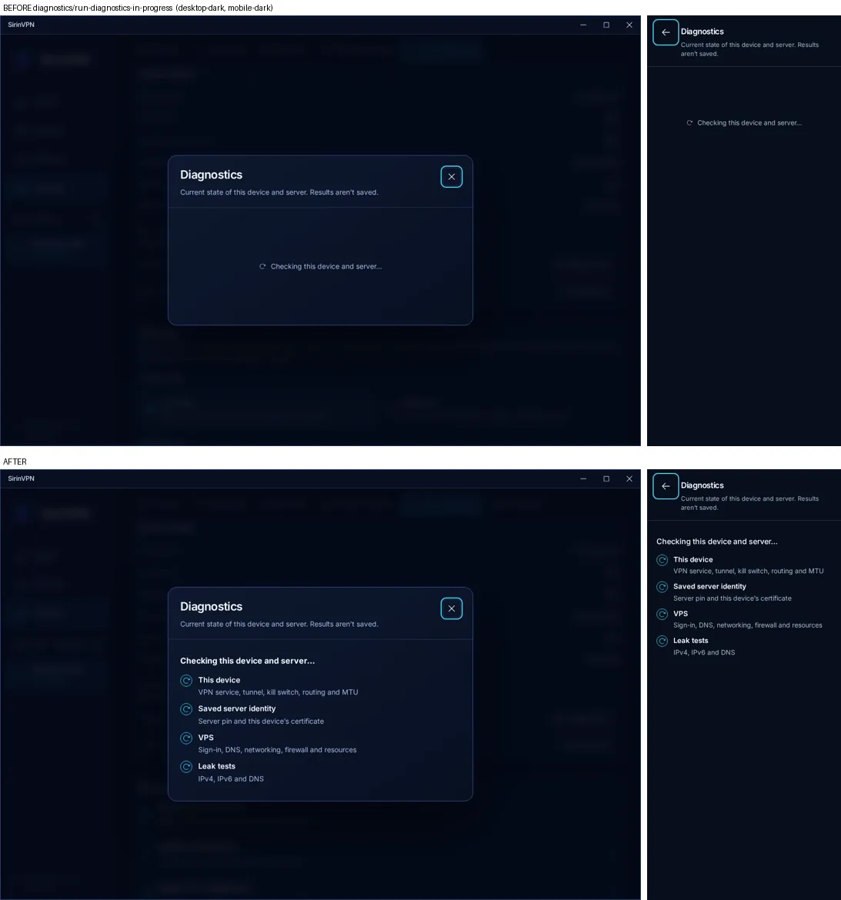
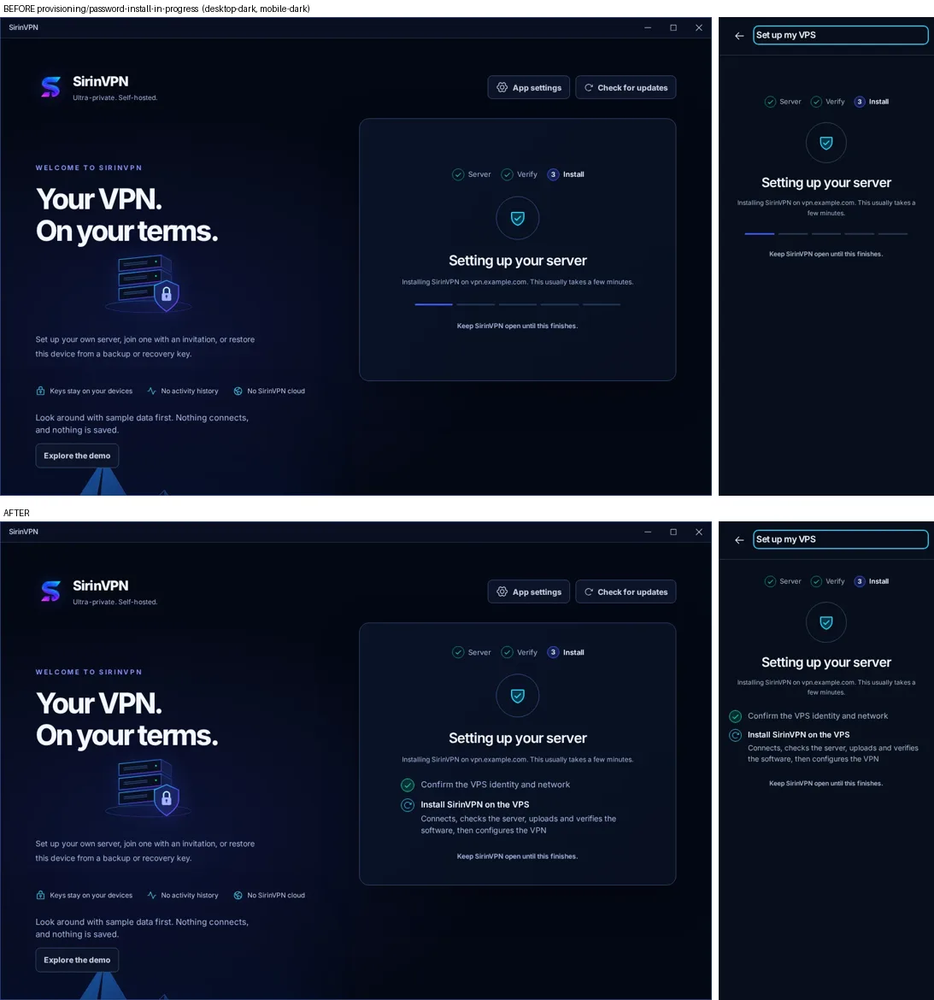

# How the app is organised

The basics come first on every page: connect, the server you use, your devices,
protection and recovery. Owner and Admin power features sit one level down,
under **Advanced**, at most two steps from the page they belong to. A first-run
Owner or a Member sees the basics without scrolling past forms they will never
use. This replaced a layout that showed every feature at the same level (2026-11-03).

## One place for each job

| Job | Desktop | Android |
| --- | --- | --- |
| Connect and see the state | Home: the status card is the focus | Home |
| Switch servers | the sidebar's **Servers** list, with a search field from six servers | Home: the **Server** row opens a sheet |
| Manage servers (rename, favorites, maintenance, add) | sidebar → **Manage** (the Servers page) | the **Servers** tab, or the sheet's **Manage servers** |
| Add a device or invite someone | Devices → **Add device** | Devices → **Add device** |
| A device's details and actions | the device's ⋯ menu → **Details** | the device's ⋮ sheet |
| A member's actions, including adding a device for them | the member's ⋯ menu | the member's ⋮ sheet |
| Protection: method, kill switch, reconnect | Settings → Connection | Settings → Connection |
| Recovery: recovery key, device and VPS backups | Settings → Keys & recovery | Settings → Keys & recovery |
| Health, diagnostics, VPS update and repair, remove | Settings → VPS maintenance | Settings → Diagnostics |

The desktop's primary navigation is Home, Devices and Settings: the sidebar's
server list already is the servers section, so a Servers item beside it only
repeated it. The Servers page outlines the selected server and says that switching
happens in the sidebar; on that page the sidebar's **Manage** button is marked as
the current place. Home names the server once, in its title. The server address moved
to Device details, and the status card says "Connected" without repeating the
name. Android keeps its four tabs: a phone has no sidebar.

## The Advanced level

| Feature | Where |
| --- | --- |
| Port forwarding | Settings → Advanced; also a device's menu → Advanced → Port forwarding |
| VPS alerts | Settings → Advanced (Owner) |
| Scheduled VPS backups | Settings → Advanced → Automatic VPS backups (Owner) |
| Device key rotation | Settings → Advanced. An unfinished rotation also stays in Keys & recovery and on Home. |
| WireGuard configurations | Devices → Add device → Advanced; a member's menu → Advanced (desktop) |
| Mutual access, device pairs, local networks | a device's menu → Advanced |
| Creating a Hetzner server | Add a server → Advanced (the row says it holds Hetzner Cloud) |

On Android's settings index the Advanced row lists what that role finds there.
Settings → Advanced also points Owners and Admins to the Advanced group of
each device's menu. Release sources stay in the update dialogs: SirinVPN ships
no built-in address, so the first check needs one, and a saved source shows as
one line with **Change**.

## By role

- **Members** see no VPS resource stats, which they can't act on. Home has no
  Server row, and Android's Connection details has no Server group. Their
  Advanced page holds key rotation, plus port forwarding when their policy
  allows it.
- **Owners and Admins** see one compact server row under Home's status card:
  CPU, memory, storage, uptime and active devices. The used and total amounts
  are under Server details. This device's traffic is one strip, not three tiles.

## Devices

The page has one add action. **Add device** opens a menu when there is a choice
(**One of my devices**, **Invite member**, and under Advanced **Add WireGuard
device**). When there is only one choice, the button does it directly and is
named for it (**Invite member** when inviting is all the caller may do). Member
cards have no add button of their own: **Add device for …** is the first item of
the member's menu, and when it is unavailable the reason also shows on the card.
Device rows have no expand chevron: **Details** is the first item of the row's
menu and opens a dialog; **Revoke** ends the menu, after the Advanced group.
Every control is a named button or menu item, a disabled item's reason is its
description for screen readers, and closing a dialog returns focus to the menu
that opened it.

## Long operations

`OperationProgress` (`components/OperationResult.tsx`) takes `steps`: each
step is done, running or not started, for screen readers too.

- **Diagnostics** and the troubleshooter list the check groups they run: this
  device, the saved identity, and, while connected, the VPS and leak tests. The
  backend runs them together and returns one report, so the groups spin
  together.
- **Backup, restore, repair and uninstall** show the phases the app runs in
  order: confirm the VPS identity, run the operation, then refresh the status or
  remove the server here. Each phase ticks as it finishes.
- **Install** lists the checked identity and network, then the install itself.
  Its stages (connect, check, upload, configure) are one backend call, so they
  are one running step.

Showing each backend stage separately would need progress events from the
backend; the app shows only what it knows.

## Primary buttons

The platform difference is deliberate. The desktop's primary action uses the
cyan-to-magenta brand gradient from the logo. Android uses Material's flat
accent fill. Within each platform, every primary button looks the same:

- On Android, a selected segment or a button left in its hover state after a
  tap no longer turns into the desktop gradient.
- On the desktop, a disabled primary or danger button has one flat neutral
  fill everywhere. Before, pages showed an empty outline and dialogs a fill.

## Checking it

`tests/ui/catalog/full_capture.py` reaches the moved controls through their new
paths ([UI state catalog](testing.md#ui-state-catalog)). Both runs below used the
same harness, on desktop (1280×860) and Android (412×915) in dark and light. The
original UI was served from `main` with `tests/ui/catalog/serve_ui.sh`.

| | Before (`main`) | After |
|---|---|---|
| Scenarios | 670 | 676 |
| States captured | 2,302 of 2,302 | 2,324 of 2,324 |
| Audit findings (contrast, text under 12px, small targets, clipping, names) | 0 | 0 |
| English UI messages shown by some state | 1,604 of 2,157 | 1,649 of 2,195 |

The new states are the Advanced settings page for each role, the Add device
menu, a member's menu and Android's Connection details for a Member; the
expanded-device-rows state went away with the expandable rows. Four reviewers
compared every changed family before and after; their findings were fixed
before the final run.

In each image the top row is before and the bottom row is after; desktop dark
comes first in each row, then Android dark.

| | |
|---|---|
| Home: the status card leads; this device and the server are one strip each |  |
| Home for a Member: no VPS resource stats |  |
| Devices: one Add device button and one menu per row |  |
| A device's Details dialog, from its menu |  |
| Servers page: managing only; the sidebar switches |  |
| Diagnostics while it runs |  |
| Install while it runs |  |
